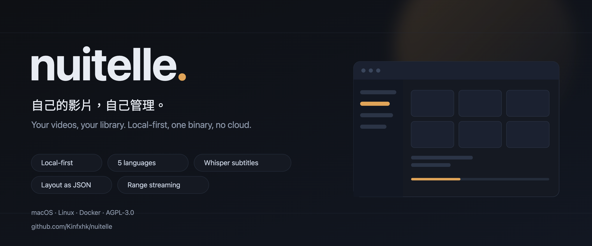
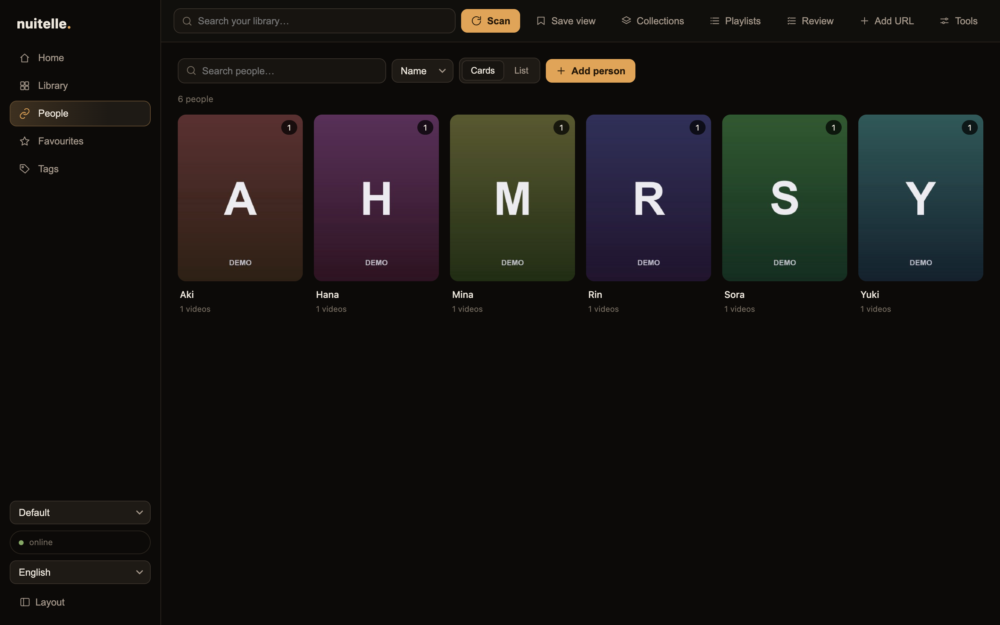
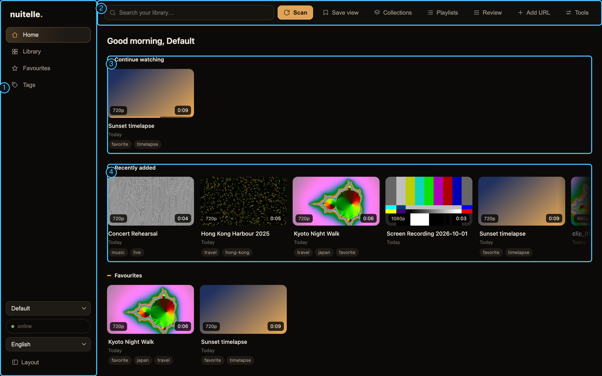
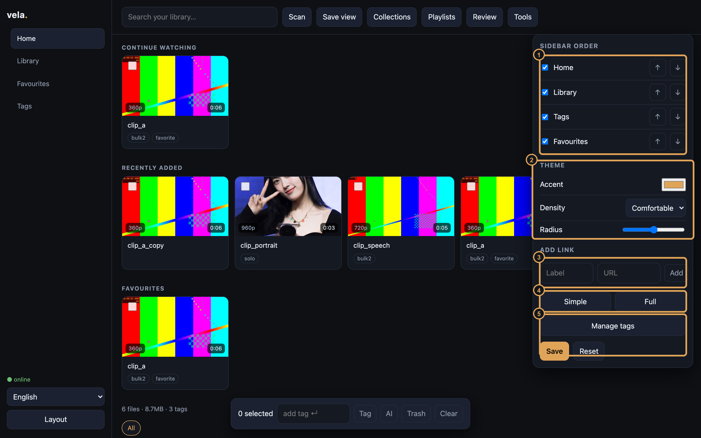
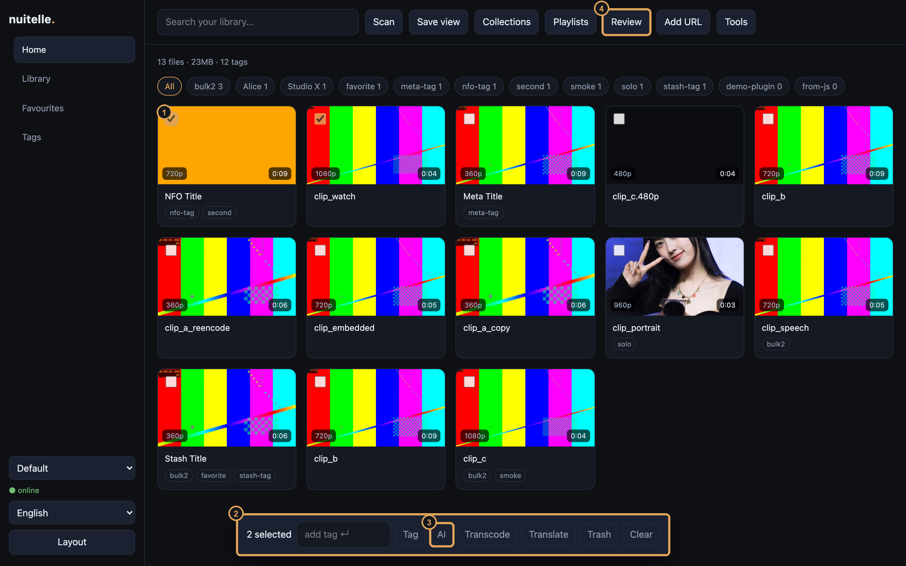

# Nuitelle

**自己的影片，自己管理。** 本地優先、單一二進位檔、無遙測、無帳號。
**Your videos, your library.** Local-first, one binary, no cloud, no accounts.

[English](#english) · [繁體中文](#繁體中文) · [Roadmap](docs/ROADMAP.md) · [Tag design](docs/TAGS.md)

> Formerly **Vela**. Existing installs keep using their `vela` config folder and `VELA_*` environment variables; new installs use `nuitelle`.

[](https://github.com/Kinfxhk/nuitelle/releases)
[](https://github.com/Kinfxhk/nuitelle/actions/workflows/ci.yml)
[](LICENSE)
[](https://go.dev)




---

## English

### People



- A dedicated **People** page with 3:4 portrait cards and a compact list (remembered per browser).
- Click a person to filter the library; the filter appears as a removable chip. Shift-click adds a second person (OR), with an AND toggle.
- Upload a portrait by picking a file or dropping it on a card; images are re-encoded to 1600 px with a 320 px thumbnail.
- Aliases, video counts, sorting (name / count / recent) and on-the-fly creation while tagging.
- User-supplied images only; the repository ships no portraits.


### Why

Your videos are already on disks, a NAS, or an external drive. You do not want to upload them anywhere, and you do not want ten apps to find one clip.

Nuitelle does one thing: **point it at your folders and get a fast, good-looking, customisable private library.** Files stay where they are; the database stores paths and metadata; playback streams the original file.

- It does not host, supply, or index content. You bring your own files.
- Binds `127.0.0.1` by default. No telemetry, no accounts.
- One Go binary + SQLite. ffmpeg is optional (covers, duration, subtitles).

### Features

- **Incremental scan** — only new/changed files; skips files still being copied.
- **Range streaming** — original file, no transcode by default; 206, seek, resume.
- **Tags, search, filters** — tag chips, instant search, FTS5 trigram index (CJK-friendly substring search).
- **One-click care** — add/remove tags, resume position, move to trash, restore in place.
- **Bulk actions** — select many items, tag them or move them to trash at once.
- **Collections** — save the current search as a named view and restore it later.
- **Playlists** — create static lists, add selected items, drag to reorder, remove items.
- **A-B loop** — mark two points in the player and loop that section.
- **Favourites and queue** — star items; previous/next, autoplay next, 0.75–2× speed.
- **Theme and links** — accent colour, density, radius, plus custom external links in the sidebar.
- **Home shelves** — continue watching, recently added, and favourites on first open; no search required.
- **Command palette** — `⌘K` / `Ctrl+K` to search media or jump to actions, with arrow keys and Enter.
- **Layout presets** — one click between Simple and Full; advanced options stay in the settings panel.
- **Desktop rail and mobile bottom nav** — a fixed rail on desktop, five-slot bottom nav on phones; ordering comes from the layout file.
- **Tag manager UI** — rename, merge, and delete tags without leaving the app.
- **Library tools** — health check (zero-byte, missing duration, orphan tags), missing-file cleanup, perceptual-hash duplicate cleanup, and path remapping.
- **Backup and restore** — export metadata as JSON (no media files) and merge it back; available in the CLI and the UI.
- **Multiple profiles** — separate resume positions and favourites per profile; switch from the bottom of the rail.
- **Add URL** — paste an http(s) file or HLS `.m3u8`; it downloads into `_ingest/` under the first root and is indexed automatically.
- **Watch folders** — while the server runs, new or changed files trigger a rescan about 3 seconds later; `--no-watch` disables it.
- **NFO and local posters** — a same-name `.nfo` supplies title/tags; `<name>-poster.jpg` or `poster.jpg` is used as the cover when present.
- **Transcode** — write a smaller H.264/AAC copy into `_transcoded/`; the original is untouched; uses VideoToolbox/NVENC/VAAPI when available, otherwise libx264.
- **Batch subtitle translation** — translate existing transcripts to a target language with a local LLM, from the bulk bar or the CLI.
- **Stash import** — `nuitelle import-stash --db …` matches by path and imports titles, tags, performers, and studio names.
- **Controller feedback** — an optional `hapticsd` daemon maps low/high audio bands to rumble; intensity is adjustable in the player.
- **JS plugins (MVP)** — a `scan.classify` hook can add tags from the file name; runs in a bare VM with no filesystem, no network, and a 2s timeout.
- **Local subtitles** — whisper.cpp on your machine, switchable models (tiny → large-v3); English translation built in, other languages via a local LLM endpoint; same-name `.srt` / `.vtt` / `.ass` sidecars and embedded subtitle tracks are discovered automatically (extracted on demand).
- **Local AI tags** — sample frames for one item, a selection, or a whole folder, ask a local vision model; batches show progress and can be cancelled; accept or reject each suggestion in the review panel; nothing is written silently.
- **Custom UI** — sidebar order, density, theme; `layout.json` imports/exports.
- **5 locales** — English, 繁體中文, 简体中文, 한국어, 日本語; follows the browser.
- **Small** — ~10MB Linux binary, low idle memory.
- **Private and hardened** — binds `127.0.0.1`; optional password login (`nuitelle passwd`) and TOTP (`nuitelle totp`); LAN mode is opt-in and token-protected; cross-site Origin and `text/plain` writes are rejected; layout JSON is schema-checked; `X-Robots-Tag: noindex`.

### Main interface



1. Rail: navigation, status, language, settings.
2. Top bar: search, scan, save view, collections, playlists, review, tools.
3. Continue-watching shelf.
4. Recently-added shelf.

- **Left rail**: brand, navigation, connection status, language, settings. Fixed on desktop, hidden on phones.
- **Top bar**: search, **Scan** (primary), then save view, collections, playlists, review, add URL, tools.
- **Home**: a time-of-day greeting with the profile name, then continue watching (with a progress bar), recently added, and favourites shelves; an install hint when empty.
- **Library**: poster grid with added date, tag filter chips, instant search, density switch. Selection checkboxes appear on hover.
- **Player**: title and Close at the top; tags with an inline add-tag field on the left; previous/next, 0.75–2× speed, subtitles, favourite and add-to-playlist on the right. The **⋯** button opens the rest: AI tags, metadata (Meta), fetch subtitles (S+), add marker (M+), A-B loop, cast, download the original, controller feedback (◎), and trash.
- **Mobile**: five-slot bottom navigation with icons (Home, Library, People, Favourites, More); the top bar and tag chips scroll sideways.
- **TV mode**: larger cards and text; arrow keys or a gamepad D-pad move focus, Enter/A opens.
- **DLNA**: `nuitelle serve --dlna` starts a read-only MediaServer on 8772 bound to the LAN IP (plus a loopback copy for local testing).

### Settings



1. Navigation order: move, show or hide.
2. Theme: accent, density, radius, TV mode.
3. Custom link: name and URL (Advanced tab).
4. Presets: Simple / Full.
5. Tag manager (Advanced tab).

Open the Layout panel from the bottom of the rail; it has Basic and Advanced tabs:

**Basic**: navigation order, presets, theme (accent/density/radius/TV), save and reset.

**Advanced**: custom links, new profile, tag manager, experimental toggles (cast / haptics / marker buttons).

- **Navigation order**: move up/down, show or hide items.
- **Presets**: Simple keeps Home, Library, People, Favourites; Full adds Tags.
- **Theme**: accent colour, density (compact/comfortable/roomy), corner radius.
- **Custom links**: name + URL, added to the rail.
- **Tag manager**: rename, merge, delete, with usage counts.
- **Save / reset**: writes `layout.json`; reset reloads the saved layout.

Other settings live in `config.json` (path below): Whisper model, vision model, translation endpoint, and address.

### Walkthrough



1. Tick the box on a card (it appears when you hover).
2. Bulk bar: appears only while items are selected; shows the count, select all, apply tag, AI, transcode, translate, trash, clear.

1. **First run**: install, then `nuitelle init`, `nuitelle scan`, `nuitelle serve`.
2. **Browse**: the home shelves open first; Library shows the full grid; the search box filters as you type.
3. **Organise**: tick the box on a card to multi-select; the bulk bar adds tags or moves items to trash.
4. **AI tags**: start a local vision server (for example llama.cpp). For one item press ⋯ → AI in the player; for a batch tick cards and press AI in the bulk bar; for a folder use Tools → AI tag a folder. Then open Review in the top bar and accept ✓ or reject ×, or accept everything ≥ 90% at once.
5. **Subtitles**: press Subtitles in the player; switch models with `nuitelle subs <id> --model small`; adjust the offset live in the player.
6. **Playback**: `←`/`→` seek 5s, space toggles, `F` fullscreen, `N` next; `⌘K` / `Ctrl+K` opens the palette.
7. **Backup**: export `layout.json` from settings or the API; back up SQLite with `VACUUM INTO`.
8. **Controller feedback (optional)**: on Linux with a USB controller, run `hapticsd --driver auto`; press ⋯ → ◎ in the player and adjust the slider. `--driver mock` tests without hardware.
9. **Phone**: run `nuitelle serve --lan`; the terminal prints `http://<LAN-IP>:8770/#token=…`. Open it on a phone on the same network; the token is stored in the browser.

### Quick start

```sh
curl -fsSL https://raw.githubusercontent.com/Kinfxhk/nuitelle/main/install.sh | sh
nuitelle init
nuitelle scan
nuitelle serve     # http://127.0.0.1:8770
nuitelle serve --lan   # phones on the same network; prints a token URL
nuitelle passwd        # optional password for the web UI
nuitelle totp          # optional TOTP second factor
nuitelle serve --dlna  # optional DLNA server on :8772
```

Docker:

```sh
docker compose up -d
```

Build from source:

```sh
git clone https://github.com/Kinfxhk/nuitelle && cd nuitelle
go build -o nuitelle . && ./nuitelle init && ./nuitelle scan && ./nuitelle serve
```

macOS 12+, Linux x64/arm64, or Windows 10+ (download the `.exe`). Go 1.23+ is only needed to build.

**Optional tools.** Playback needs nothing else. ffmpeg/ffprobe add covers, duration and transcode; whisper.cpp plus a model adds local subtitles. The installer checks them and offers to install what is missing; you can re-run the check any time:

```sh
nuitelle doctor          # report what is installed and what each missing tool unlocks
nuitelle doctor --fix    # ask, then install missing tools and download the whisper model
nuitelle doctor --yes    # same, without asking (scripts)
```

`--fix` uses Homebrew (macOS), apt / dnf / pacman (Linux, via sudo) or winget (Windows ffmpeg). The whisper model (`whisper_model`, default `base`) is downloaded from Hugging Face into `~/.nuitelle/models` and checked against its SHA-256 before use. When no package exists (whisper.cpp on Windows, older Debian/Ubuntu), doctor prints the manual step. Skip the installer check with `NUITELLE_DEPS=skip`, or accept everything with `NUITELLE_DEPS=yes`.

### Subtitles (local Whisper)

```sh
nuitelle subs <media-id> --model base --lang auto
nuitelle subs <media-id> --model small --lang ja --translate en
```

備份：

```sh
nuitelle backup --out nuitelle.db      # consistent SQLite snapshot
nuitelle export --out backup.json  # metadata only
nuitelle import --in backup.json
```

由 Stash 遷移（按檔案路徑配對，匯入標題、標籤、演出者與片商名稱）：

```sh
nuitelle import-stash --db ~/.stash/stash-go.sqlite
```

加入網址：

```sh
nuitelle ingest https://example.com/clip.mp4
nuitelle ingest https://example.com/playlist.m3u8
nuitelle transcode <id> --height 720
nuitelle translate <id> --to zh-Hant
```

- Models: `tiny` / `base` / `small` / `medium` / `large-v3`, or a `.bin` path. Default `base` at `~/.nuitelle/models/ggml-<model>.bin`.
- Writes SRT, stores it in the database; the player attaches a `<track>` automatically with a language selector.
- English translation uses whisper `--translate`; zh-Hant / zh-Hans / ko / ja translation uses a local OpenAI-compatible endpoint (default Ollama `127.0.0.1:11434`, model configurable).

### Plugins

Drop a plugin in `<config>/plugins/<id>/` with `manifest.json` and `plugin.js`:

```json
{"id": "example.hello", "version": "1.0.0", "hooks": ["scan.classify"]}
```

```js
function scanClassify(input) {
  return { tags: /sample/i.test(input.title) ? ["sample"] : [] };
}
```

- Runs during scans; returned tags are added to that item.
- No filesystem, network, or timers; a 2s limit aborts runaway scripts.
- The official repo ships no site scrapers; users install plugins themselves.
- Hooks: `scan.classify` (tags during scans), `metadata.fetch` (player Meta button), and `subtitle.fetch` (player S+ button, returning a language and SRT).
- Optional `ui` (HTML file) and `ui_title`: listed in Tools and opened in a sandboxed iframe with `sandbox allow-scripts`; no parent access.
- Example: `examples/plugins/hello/`.

### Custom UI

`layout.json` controls sidebar order and visibility. Reorder in the UI or `GET/PUT /api/layout`. Layouts are portable.

### API

| Method | Path | Purpose |
|---|---|---|
| GET | `/api/health` | server + scan state |
| GET | `/api/stats` | files, bytes, duration, tags |
| GET | `/api/media?q=&tag=&sort=&limit=&offset=` | list/search |
| GET | `/api/media/{id}` | detail + resume position |
| GET | `/api/media/{id}/stream` | Range streaming |
| GET | `/api/media/{id}/cover` | JPEG thumbnail |
| GET | `/api/media/{id}/subtitles` | list tracks |
| GET | `/api/media/{id}/subtitles/{lang}?kind=` | WebVTT |
| POST | `/api/media/{id}/subtitles` | generate (local) |
| POST | `/api/media/{id}/tags` | `{"add":[],"remove":[]}` |
| POST | `/api/media/{id}/progress` | `{"position_ms":1234}` |
| POST | `/api/media/{id}/trash` | move to `.nuitelle-trash/` |
| POST | `/api/media/{id}/restore` | move back |
| POST | `/api/scan` | `{"full":false}` |
| GET/PUT | `/api/layout` | UI layout JSON |
| GET/POST | `/api/collections` | saved searches |
| DELETE | `/api/collections/{id}` | delete a saved search |
| GET | `/api/duplicates` | same size + duration groups |
| GET | `/api/library/health` | zero-byte, missing duration, orphan tags |
| POST | `/api/remap` | rewrite a path prefix after a move |
| POST | `/api/bulk` | tag / untag / trash / restore many |
| POST | `/api/tags/rename` | rename (merges on conflict) |
| POST | `/api/tags/merge` | merge two tags |
| POST | `/api/tags/alias` | alias → canonical tag |
| DELETE | `/api/tags/{name}` | delete a tag |

### FAQ

**Is Nuitelle a downloader?** No. It indexes folders you already own. A generic URL ingest is on the roadmap; there are no site-specific extractors in core.

**Does it upload anything?** No. No telemetry, no accounts, no cloud calls.

**Why Go?** The bottleneck is disk, SQLite, and ffmpeg, not HTTP throughput. Go gives one static binary per platform and a small memory footprint.

**Can I use it on a NAS?** Yes. Run the binary or the Docker image on the NAS and mount media read-only. Keep the database on local disk.

### Docs

- [Feature inventory](docs/FEATURES.md)
- [Roadmap](docs/ROADMAP.md)
- [Tag design](docs/TAGS.md)
- [UI review](docs/UI-REVIEW.md)

### License

AGPL-3.0-or-later. See [LICENSE](LICENSE). The name and logo are not covered by the code license.

---

## 繁體中文

### 演出者


- 獨立「演出者」頁：3:4 人像卡片與精簡清單（每部瀏覽器記住選擇）。
- 點擊人物即篩選媒體庫，頂部出現可移除 chip；Shift 點擊可加第二人（OR），另有 AND 切換。
- 可選檔上傳或把圖片拖到卡片；圖片會重新編碼為長邊 1600px，並生成 320px 縮圖。
- 支援別名、影片數量、排序（名稱／數量／最近）以及標籤時即場新增人物。
- 只接受用戶自行提供的圖片；repo 不附任何肖像。


### 為何

你的影片分散在硬碟、NAS 或外接硬碟之中。你不希望將它們上傳到任何地方，也不希望為了尋找一段影片而安裝十個應用程式。

Nuitelle 只做一件事：**指定你的資料夾，建立一個快速、美觀、可自訂的私人媒體庫。** 檔案留在原位，資料庫只記錄路徑與中繼資料，播放時直接串流原始檔案。

- 不托管、不提供、不索引任何內容；你使用自己的檔案。
- 預設只綁定 `127.0.0.1`，無遙測、無帳號。
- 單一 Go 二進位檔 + SQLite；ffmpeg 為可選項（封面、時長、字幕）。

### 功能

- **增量掃描** — 只處理新增或修改過的檔案，跳過尚未複製完成的檔案。
- **Range 串流** — 直接播放原始檔案，預設不轉碼；支援 206、seek、resume。
- **標籤、搜尋、篩選** — tag chips、即時搜尋；FTS5 trigram 索引，支援中文與部分字串。
- **一鍵整理** — 新增或移除標籤、續播位置、移至垃圾桶、原路徑還原。
- **批次操作** — 多選影片後一次加標籤或移到垃圾桶。
- **合集／儲存檢視** — 將目前的搜尋條件存成合集，日後一按重現。
- **播放清單** — 建立靜態清單、加入多選影片、拖曳調整次序、移除項目。
- **A-B 循環** — 播放器內標記兩個時間點，自動循環該段。
- **收藏與隊列** — 星標收藏；播放器支援上一條／下一條、播完自動接續、0.75–2× 速度。
- **主題與自訂連結** — 主色、密度、圓角，以及側欄自訂外部連結。
- **主頁貨架** — 繼續觀看、最近加入、收藏三個貨架，開啟即見；不需要先搜尋。
- **命令面板** — `⌘K`／`Ctrl+K` 搜尋媒體或跳轉功能，支援鍵盤上下與 Enter。
- **版面預設** — 「簡潔」與「完整」一鍵切換；進階選項收在設定面板內。
- **桌面側欄與手機底部導覽** — 桌面用固定側欄，手機用底部五格導覽；排序由版面設定控制。
- **標籤管理介面** — 直接在介面改名、合併、刪除標籤。
- **資料庫工具** — 健康檢查（0 byte、缺時長、孤兒標籤）、缺失檔清理、感知雜湊重複檔一鍵清理、路徑重映射。
- **備份與還原** — 匯出 JSON metadata（不含影片檔），可重新匯入並合併；CLI 與介面皆可。
- **多使用者進度與收藏** — 可建立多個 profile，續播位置與收藏各自獨立；介面左下切換。
- **加入網址** — 貼上 http(s) 直連或 HLS `.m3u8`，下載到第一個媒體夾的 `_ingest/` 後自動入庫。
- **Watch folders** — 伺服器執行時監察媒體夾，新增或改動後約 3 秒自動重新掃描；`--no-watch` 可關閉。
- **NFO 與本地封面** — 同名 `.nfo` 的標題／標籤會自動套用；同資料夾的 `<name>-poster.jpg`／`poster.jpg` 會優先作封面。
- **轉碼** — 將選取項目輸出成較細的 H.264／AAC 版本到 `_transcoded/`，原檔不變；自動選用 VideoToolbox／NVENC／VAAPI，否則 libx264。
- **批次字幕翻譯** — 對已有轉錄批次翻成目標語言（本機 LLM），可從多選工具列或 CLI 執行。
- **手掣回饋** — 可選的 `hapticsd` 守護程序，把播放聲音的低頻／高頻轉成手掣震動；播放器可調強弱。
- **JS 插件（MVP）** — 掃描時執行 `scan.classify`，可依檔名補標籤；在無檔案、無網絡的沙箱執行，2 秒上限。
- **本地字幕** — 使用 whisper.cpp 在你的電腦轉錄，模型可切換（tiny → large-v3）；可翻譯成英文，其他語言可連接本地 LLM；亦會自動發現同名 `.srt`／`.vtt`／`.ass` 字幕檔，以及容器內嵌字幕軌（按需抽取）。
- **本機 AI 標籤** — 單片、多選批次或整個資料夾抽取畫面幀，交由本機視覺模型提出建議；批次有進度與取消；可在審核面板逐個接受或拒絕，不會自動寫入。
- **自訂介面** — sidebar 次序、密度、主題；`layout.json` 可匯入／匯出。
- **五種語言** — 繁體中文、简体中文、English、한국어、日本語；跟隨瀏覽器自動選擇。
- **輕量** — Linux 二進位檔約 10MB，閒置記憶體低。
- **私隱與本機防護** — 預設只綁 `127.0.0.1`；可選密碼登入（`nuitelle passwd`）與 TOTP 兩步驗證（`nuitelle totp`）；LAN 模式需明確開啟並使用隨機 token；拒絕跨站 Origin 與 `text/plain` 寫入；版面 JSON 有 schema 檢查；`X-Robots-Tag: noindex`。

### 主介面


1. 側欄：導覽、連線狀態、語言、設定。
2. 頂欄：搜尋、掃描、儲存檢視、合集、播放清單、審核、工具。
3. 繼續觀看貨架。
4. 最近加入貨架。

- **左側側欄**：品牌、導覽項目、連線狀態、語言選擇、設定入口。桌面固定顯示，手機自動收起。
- **頂欄**：搜尋、**掃描**（主按鈕），之後是儲存檢視、合集、播放清單、審核、加入網址、工具。
- **首頁**：依時段顯示問候語與 profile 名稱，下面是繼續觀看（附進度條）、最近加入、收藏三個貨架；沒有內容時顯示安裝提示。
- **媒體庫**：海報網格（附加入日期）、標籤篩選、即時搜尋；可切換密度。滑鼠移到卡片上才顯示勾選方框。
- **播放器**：頂部為標題與「關閉」；左邊是標籤及直接加標籤的輸入框；右邊是上一條／下一條、0.75–2× 速度、字幕、收藏、加入播放清單。按 **⋯** 展開其餘功能：AI 標籤、Meta（取得資料）、S+（取得字幕）、M+（加時間標記）、A-B 循環、投放、下載原檔、手掣回饋（◎）及移至垃圾桶。
- **手機**：底部五格圖示導覽（首頁、媒體庫、標籤、收藏、更多）；頂欄與標籤列可左右捲動。
- **電視模式**：設定內開啟後放大卡片與字體，方向鍵／手掣十字鍵移動焦點，Enter／A 鍵開啟。
- **DLNA**：`nuitelle serve --dlna` 會在區網 IP 的 8772 開啟唯讀 MediaServer（另留 loopback 供本機測試），電視／播放器可直接瀏覽與串流。

### 設定頁面


1. 導覽次序：上下移動、顯示或隱藏。
2. 主題：主色、密度、圓角、電視模式。
3. 自訂連結：名稱與網址（進階分頁）。
4. 版面預設：簡潔／完整。
5. 標籤管理（進階分頁）。

按側欄底部的「版面」開啟設定面板，分「基本」與「進階」兩頁：

**基本**：導覽次序、版面預設、主題（主色／密度／圓角／電視模式）、儲存與還原。

**進階**：自訂連結、新使用者、標籤管理、實驗功能（投放／震動／標記按鈕開關）。

- **導覽次序**：上下移動、勾選顯示或隱藏。
- **版面預設**：「簡潔」只保留首頁、媒體庫、收藏；「完整」加入標籤。
- **主題**：主色、密度（緊湊／舒適／寬鬆）、圓角。
- **自訂連結**：輸入名稱與網址，加入側欄。
- **標籤管理**：改名、合併、刪除，並顯示每個標籤的使用次數。
- **儲存／還原**：儲存後寫入 `layout.json`；還原會重新載入已儲存版本。

其他設定位於 `config.json`（路徑見下方），包括 Whisper 模型、視覺模型、翻譯端點與連接埠。

### 操作教學


1. 勾選卡片左上角方框（滑鼠移到卡片上時出現）。
2. 底部批次列：只在有選取時出現，顯示已選數目，提供全選、套用標籤、AI、轉碼、翻譯、垃圾桶、清除。

1. **首次安裝**：執行安裝指令，依序執行 `nuitelle init`、`nuitelle scan`、`nuitelle serve`。
2. **瀏覽**：首頁貨架直接開啟；按「媒體庫」進入完整網格；搜尋框即時過濾。
3. **整理**：勾選卡片左上角方框可多選，底部出現批次列，可加標籤或移至垃圾桶。
4. **AI 標籤**：先啟動本機視覺模型（例如 llama.cpp server）。單片可在播放器按「⋯」→「AI」；批次可勾選多張卡片後按底部「AI」；整個資料夾可在「工具」輸入路徑後按套用。完成後在頂欄「審核」逐個按 ✓／×，或一次接受 ≥ 90% 的建議。
5. **字幕**：在播放器按「字幕」生成；模型可用 `nuitelle subs <id> --model small` 切換；播放器可即時加減字幕偏移。
6. **播放**：`←`／`→` 前後 5 秒、空白鍵播放暫停、`F` 全螢幕、`N` 下一條；`⌘K`／`Ctrl+K` 開命令面板。
7. **備份**：`layout.json` 可從設定面板或 API 匯出；資料庫可用 SQLite 的 `VACUUM INTO` 備份。
8. **手掣回饋（可選）**：在 Linux 以 USB 接上手掣，執行 `hapticsd --driver auto`；播放器按「⋯」→ ◎ 開啟，旁邊滑桿調強弱。`--driver mock` 可在沒有手掣時測試。
9. **手機**：執行 `nuitelle serve --lan`，終端機會印出 `http://<區網 IP>:8770/#token=…`；手機在同一網段打開即可，token 會自動存入瀏覽器。

### 快速開始

```sh
curl -fsSL https://raw.githubusercontent.com/Kinfxhk/nuitelle/main/install.sh | sh
nuitelle init      # 選擇資料夾與連接埠
nuitelle scan      # 建立索引
nuitelle serve     # 開啟 http://127.0.0.1:8770
nuitelle serve --lan   # 同網段手機可用；啟動時印出帶 token 的網址
nuitelle passwd        # 可選：設定網頁登入密碼
nuitelle totp          # 可選：啟用 TOTP 兩步驗證
nuitelle serve --dlna  # 可選：8772 開啟 DLNA
```

Docker：

```sh
docker compose up -d
```

如需自行建置：

```sh
git clone https://github.com/Kinfxhk/nuitelle && cd nuitelle
go build -o nuitelle . && ./nuitelle init && ./nuitelle scan && ./nuitelle serve
```

需要 macOS 12+ / Linux x64 / arm64，或 Windows 10+（下載 `.exe`）；Go 1.23+ 僅在建置時需要。

**可選工具。** 單純播放不需要其他工具。ffmpeg／ffprobe 提供封面、時長與轉碼；whisper.cpp 加模型提供本機字幕。安裝程式會檢查這些工具，並詢問是否安裝缺少的部分；之後隨時可再檢查：

```sh
nuitelle doctor          # 列出已安裝與缺少的工具，以及缺少時失去哪些功能
nuitelle doctor --fix    # 詢問後安裝缺少的工具，並下載 whisper 模型
nuitelle doctor --yes    # 同上，不詢問（適合腳本）
```

`--fix` 會使用 Homebrew（macOS）、apt／dnf／pacman（Linux，經 sudo）或 winget（Windows 的 ffmpeg）。whisper 模型（`whisper_model`，預設 `base`）從 Hugging Face 下載到 `~/.nuitelle/models`，使用前會核對 SHA-256。沒有現成套件時（Windows 的 whisper.cpp、較舊的 Debian／Ubuntu），doctor 會列出手動步驟。安裝時可用 `NUITELLE_DEPS=skip` 略過檢查，或用 `NUITELLE_DEPS=yes` 全部自動安裝。

### 字幕（本地 Whisper）

```sh
nuitelle subs <media-id> --model base --lang auto
nuitelle subs <media-id> --model small --lang ja --translate en
```

備份：

```sh
nuitelle backup --out nuitelle.db      # consistent SQLite snapshot
nuitelle export --out backup.json  # metadata only
nuitelle import --in backup.json
```

由 Stash 遷移（按檔案路徑配對，匯入標題、標籤、演出者與片商名稱）：

```sh
nuitelle import-stash --db ~/.stash/stash-go.sqlite
```

加入網址：

```sh
nuitelle ingest https://example.com/clip.mp4
nuitelle ingest https://example.com/playlist.m3u8
nuitelle transcode <id> --height 720
nuitelle translate <id> --to zh-Hant
```

- 模型：`tiny` / `base` / `small` / `medium` / `large-v3`，或直接提供 `.bin` 路徑。預設 `base`，存放於 `~/.nuitelle/models/ggml-<model>.bin`。
- 轉錄輸出 SRT，存入資料庫；播放器自動掛載 `<track>`，可選擇語言或關閉。
- 英文翻譯使用 whisper 內建 `--translate`；繁體中文／简体中文／韓文／日文翻譯連接本地 OpenAI-compatible endpoint（預設 Ollama `127.0.0.1:11434`，模型可更改）。

### 插件

插件放在 `<config>/plugins/<id>/`，需要 `manifest.json` 與 `plugin.js`：

```json
{"id": "example.hello", "version": "1.0.0", "hooks": ["scan.classify"]}
```

```js
function scanClassify(input) {
  return { tags: /sample/i.test(input.title) ? ["sample"] : [] };
}
```

- 只在掃描時執行；回傳的標籤會加入該媒體。
- 沙箱沒有檔案、網絡、計時器；超過 2 秒會中止。
- 官方 repo 不提供任何站點 scraper；插件由用戶自行安裝。
- Hook：`scan.classify`（掃描時補標籤）、`metadata.fetch`（播放器「Meta」按鈕）、`subtitle.fetch`（播放器「S+」按鈕，回傳語言與 SRT）。
- 可選 `ui`（HTML 檔）與 `ui_title`：工具面板會列出並以沙箱 iframe 開啟，CSP `sandbox allow-scripts`，不能存取父頁。
- 範例：`examples/plugins/hello/`。

### 自訂介面

`layout.json` 控制 sidebar 次序與顯示；可直接在介面上下移動，亦可使用 `GET/PUT /api/layout`。版面可以備份、分享、搬遷。

### 語言

介面內建 English、繁體中文、简体中文、한국어、日本語；可使用 `?lang=ja` 或跟隨瀏覽器語言自動選擇，選擇儲存於 `localStorage`。

### 文件

- [功能清單](docs/FEATURES.md)
- [Roadmap](docs/ROADMAP.md)
- [標籤設計](docs/TAGS.md)
- [介面檢討](docs/UI-REVIEW.md)
- API：見上方 English › API

### 授權

AGPL-3.0-or-later。名稱與 logo 不包含在程式碼授權內；fork 不得使用。
