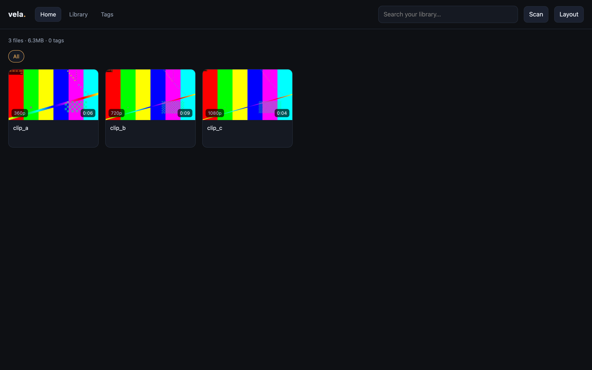
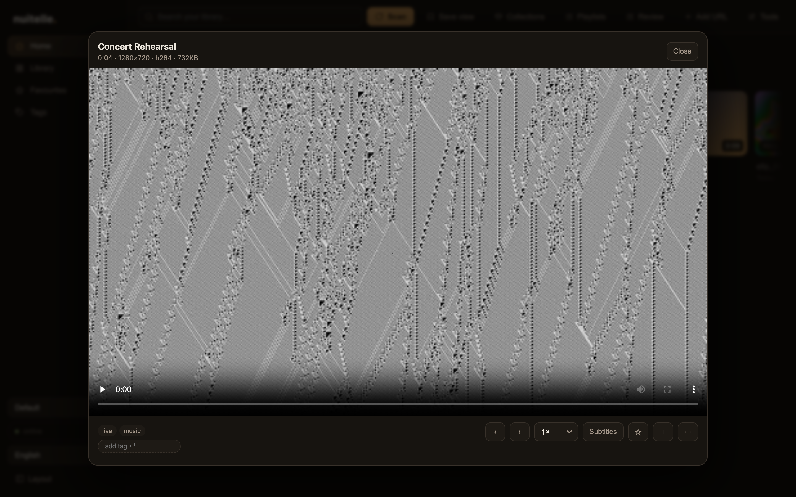

# Vela

**自己嘅影片，自己管。** 本地優先、單一 binary、無 telemetry、無帳號。
**Your videos, your library.** Local-first, one binary, no cloud, no accounts.

[繁體中文](#繁體中文) · [English](#english) · [Roadmap](docs/ROADMAP.md) · [Tag design](docs/TAGS.md)

[](https://github.com/Kinfxhk/vela/releases)
[](https://github.com/Kinfxhk/vela/actions/workflows/ci.yml)
[](LICENSE)
[](https://go.dev)





---

## 繁體中文

### 為何

你已經有一堆影片，散落在硬碟、NAS、外接碟。你唔想 upload 去任何地方，亦唔想開十個 app 去搵一套片。

Vela 只做一件事：**指去你嘅資料夾，建立一個快、靚、可以自己改嘅私人媒體庫。** 檔案留在原位，資料庫只記路徑同 metadata，播放直接串原本檔案。

- 唔托管、唔提供、唔索引任何內容；你帶自己嘅檔案。
- 預設只 bind `127.0.0.1`，無 telemetry、無帳號。
- 一個 Go binary + SQLite；ffmpeg 可選（封面、時長、字幕）。

### 功能

- **增量掃描** — 只處理新檔／改過的檔，跳過未 copy 完嘅檔。
- **Range 串流** — 原檔直接播，預設唔轉碼；支援 206、seek、resume。
- **標籤、搜尋、篩選** — tag chips、即時搜尋、SQLite 索引。
- **一鍵整理** — 加減 tag、續播位置、移到垃圾桶、原路徑還原。
- **本地字幕** — 用 whisper.cpp 喺你部機轉錄，模型可切換（tiny → large-v3）；可翻成英文，其他語言可接本地 LLM。
- **自訂介面** — sidebar 次序、密度、主題；`layout.json` 可以 import/export。
- **5 種語言** — 繁中、简中、English、한국어、日本語；跟瀏覽器自動選。
- **細** — Linux binary ~10MB，idle 記憶體低。
- **私隱** — `X-Robots-Tag: noindex`，Private mode 一鍵關對外 listener。

### 快速開始

```sh
curl -fsSL https://raw.githubusercontent.com/Kinfxhk/vela/main/install.sh | sh
vela init      # 選資料夾同 port
vela scan      # 建立索引
vela serve     # 開 http://127.0.0.1:8770
```

Docker：

```sh
docker compose up -d
```

想自己 build：

```sh
git clone https://github.com/Kinfxhk/vela && cd vela
go build -o vela . && ./vela init && ./vela scan && ./vela serve
```

需要 macOS 12+ / Linux x64 / arm64；Go 1.23+ 只係 build 時需要。`vela doctor` 會檢查資料夾、ffmpeg、DB、port。

### 字幕（本地 Whisper）

```sh
vela subs <media-id> --model base --lang auto
vela subs <media-id> --model small --lang ja --translate en
```

- 模型：`tiny` / `base` / `small` / `medium` / `large-v3`，或直接給 `.bin` 路徑。預設 `base`，放喺 `~/.vela/models/ggml-<model>.bin`。
- 轉錄輸出 SRT，存入資料庫；播放器自動掛 `<track>`，可以揀語言或關閉。
- 英文翻譯用 whisper 內建 `--translate`；繁中／简中／韓／日翻譯接本地 OpenAI-compatible endpoint（預設 Ollama `127.0.0.1:11434`，模型可改）。

### 自訂介面

`layout.json` 控制 sidebar 次序同顯示；UI 可以直接上下移，亦可 `GET/PUT /api/layout`。版面可以備份、分享、搬機。

### 語言

UI 內建 English、繁體中文、简体中文、한국어、日本語；`?lang=ja` 或瀏覽器語言自動選擇，選擇存在 `localStorage`。

### 文件

- [Roadmap](docs/ROADMAP.md)
- [Tag 設計](docs/TAGS.md)
- API：見下面 English › API

### 授權

AGPL-3.0-or-later。名稱同 logo 唔包含在代碼授權內；fork 唔可以用。

---

## English

### Why

Your videos are already on disks, a NAS, or an external drive. You do not want to upload them anywhere, and you do not want ten apps to find one clip.

Vela does one thing: **point it at your folders and get a fast, good-looking, customisable private library.** Files stay where they are; the database stores paths and metadata; playback streams the original file.

- It does not host, supply, or index content. You bring your own files.
- Binds `127.0.0.1` by default. No telemetry, no accounts.
- One Go binary + SQLite. ffmpeg is optional (covers, duration, subtitles).

### Features

- **Incremental scan** — only new/changed files; skips files still being copied.
- **Range streaming** — original file, no transcode by default; 206, seek, resume.
- **Tags, search, filters** — tag chips, instant search, SQLite index.
- **One-click care** — add/remove tags, resume position, move to trash, restore in place.
- **Local subtitles** — whisper.cpp on your machine, switchable models (tiny → large-v3); English translation built in, other languages via a local LLM endpoint.
- **Custom UI** — sidebar order, density, theme; `layout.json` imports/exports.
- **5 locales** — English, 繁體中文, 简体中文, 한국어, 日本語; follows the browser.
- **Small** — ~10MB Linux binary, low idle memory.
- **Private** — `X-Robots-Tag: noindex`; private mode stops non-loopback listeners.

### Quick start

```sh
curl -fsSL https://raw.githubusercontent.com/Kinfxhk/vela/main/install.sh | sh
vela init
vela scan
vela serve     # http://127.0.0.1:8770
```

Docker:

```sh
docker compose up -d
```

Build from source:

```sh
git clone https://github.com/Kinfxhk/vela && cd vela
go build -o vela . && ./vela init && ./vela scan && ./vela serve
```

macOS 12+ / Linux x64 / arm64. Go 1.23+ is only needed to build. `vela doctor` checks folders, ffmpeg, database, and port.

### Subtitles (local Whisper)

```sh
vela subs <media-id> --model base --lang auto
vela subs <media-id> --model small --lang ja --translate en
```

- Models: `tiny` / `base` / `small` / `medium` / `large-v3`, or a `.bin` path. Default `base` at `~/.vela/models/ggml-<model>.bin`.
- Writes SRT, stores it in the database; the player attaches a `<track>` automatically with a language selector.
- English translation uses whisper `--translate`; zh-Hant / zh-Hans / ko / ja translation uses a local OpenAI-compatible endpoint (default Ollama `127.0.0.1:11434`, model configurable).

### Custom UI

`layout.json` controls sidebar order and visibility. Reorder in the UI or `GET/PUT /api/layout`. Layouts are portable.

### API

| Method | Path | Purpose |
|---|---|---|
| GET | `/api/health` | server + scan state |
| GET | `/api/stats` | files, bytes, duration, tags |
| GET | `/api/media?q=&tag=&sort=&limit=&offset=` | list/search |
| GET | `/api/media/{id}` | detail + resume position |
| GET | `/api/media/{id}/stream` | Range streaming |
| GET | `/api/media/{id}/cover` | JPEG thumbnail |
| GET | `/api/media/{id}/subtitles` | list tracks |
| GET | `/api/media/{id}/subtitles/{lang}?kind=` | WebVTT |
| POST | `/api/media/{id}/subtitles` | generate (local) |
| POST | `/api/media/{id}/tags` | `{"add":[],"remove":[]}` |
| POST | `/api/media/{id}/progress` | `{"position_ms":1234}` |
| POST | `/api/media/{id}/trash` | move to `.vela-trash/` |
| POST | `/api/media/{id}/restore` | move back |
| POST | `/api/scan` | `{"full":false}` |
| GET/PUT | `/api/layout` | UI layout JSON |

### FAQ

**Is Vela a downloader?** No. It indexes folders you already own. A generic URL ingest is on the roadmap; there are no site-specific extractors in core.

**Does it upload anything?** No. No telemetry, no accounts, no cloud calls.

**Why Go?** The bottleneck is disk, SQLite, and ffmpeg, not HTTP throughput. Go gives one static binary per platform and a small memory footprint.

**Can I use it on a NAS?** Yes. Run the binary or the Docker image on the NAS and mount media read-only. Keep the database on local disk.

### Docs

- [Roadmap](docs/ROADMAP.md)
- [Tag design](docs/TAGS.md)

### License

AGPL-3.0-or-later. See [LICENSE](LICENSE). The name and logo are not covered by the code license.
